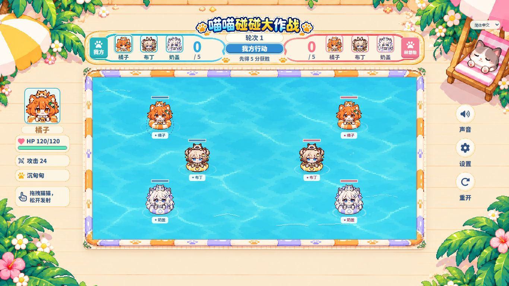

# 喵喵碰碰大作战

> 猫娘套泳圈，小猫满池弹。

调整角度和力度，把猫猫弹出去：撞上对手、带动队友、借池壁反弹，再看她们慢慢停下来。既可以认真算路线，也可以享受意料之外的连撞。

这是为 [N.E.K.O](https://github.com/Project-N-E-K-O/N.E.K.O) 制作的本机三对三猫娘泳圈小游戏，玩法灵感来自《崩坏：星穹铁道》的「豹豹碰碰大作战」。

**版本 0.3.0** · **作者 [WhiteFrostune](https://github.com/WhiteFrostune)**



## 这一版能玩什么

- 橘子、布丁、奶盖、原皮悠怡和洛丽塔悠怡各有血量、攻击与技能。每队五选三，两只悠怡可以同时上场。
- 双方轮流弹射，每只猫每轮有一次常规出手，先得 5 分获胜。原皮悠怡可通过淘汰获得一次额外出手。
- 泳圈互撞、池壁反弹和水阻，支持借队友打出连续碰撞。
- 从备战大厅选择出战顺序和地图，也可以点「换一组对手」重抽电脑阵容。对局结束后可以直接再开一局，或回大厅重新搭配。
- 五只猫都有开场入水、返场和脱圈击飞动画。橘子、布丁和奶盖在选猫页有亮相与待机动画，两只悠怡使用立绘。
- 夏日泳池有动态水纹、泳圈尾流和入水水花。关键撞击配有镜头和慢动作，血条显示伤害与回复。音效可关闭。
- 独立自由练习，可切换布局反复试路线。
- 对局界面支持简体中文、繁體中文、English、日本語、한국어、Русский、Español、Português。备战大厅的部分界面文字目前为简体中文。

后续计划接入 N.E.K.O 的猫娘，让猫娘作为对手参与对战。当前版本先使用本机电脑逻辑，不调用模型，也不需要额外账号或外部网络服务。

## 安装与打开

从 v0.3.0 的 Release 下载 **miao_miao_bump.neko-plugin**，在 N.E.K.O 的插件管理器中导入。安装后刷新列表，启动「喵喵碰碰大作战」，点击游戏入口进入备战大厅。下载页同时提供安装包的 SHA-256 校验文件。

[下载安装包](https://github.com/WhiteFrostune/n.e.k.o_plugin_miao_miao_bump/releases/download/v0.3.0/miao_miao_bump.neko-plugin) · [下载 SHA256SUMS.txt](https://github.com/WhiteFrostune/n.e.k.o_plugin_miao_miao_bump/releases/download/v0.3.0/SHA256SUMS.txt)

源码方式：将本仓库放在 N.E.K.O 的 `plugin/plugins/miao_miao_bump/` 目录，再刷新插件列表并启动。目录已经存在时继续使用原目录，避免重复克隆。

也可以在 N.E.K.O 源码根目录启动独立浏览器预览：

```bash
uv run python -m http.server 48921 --bind 127.0.0.1 --directory plugin/plugins/miao_miao_bump
```

保持预览服务运行，打开 [本机备战大厅](http://127.0.0.1:48921/static/preparation.html?locale=zh-CN)。游戏不能直接双击 HTML 文件打开。

## 怎么玩

首次打开时，我方三个出战位为空。点任意「＋」泳圈打开猫猫列表，按想要的上阵顺序点选三只猫，头像左上角会显示 1、2、3。再次点击已选猫猫可取消。确认阵容后，可用「开始对战」旁的「选择地图」查看场地。

1. 轮到我方、场上停稳时，按住一只本轮还没出手的己方猫猫或泳圈。
2. 向后拖拽，调整方向与力度；松手后向相反方向弹出。
3. 拖回按下位置附近、移出游戏画面，或拖到泳池右下角的取消区，松手即可取消。Esc 和右键也能取消。
4. 等碰撞结束再选择下一只猫。头像上的 **✓** 表示已行动，被撞动不会消耗主动机会。

第一轮我方先手，之后每轮交换先手。一方还有猫在场但用完了机会，由另一方完成剩余行动。双方机会用完，或一方的猫全部被淘汰时，本次碰撞和击飞结束后进入下一轮；达到目标分则结算。

**伤害看当前行动方：** 我方行动时，对手碰到任意我方猫猫，都会受到这只我方猫猫的攻击伤害，包括静止或已经行动的队友；对方行动时反过来。同阵营不互伤，撞墙不扣血。持续贴住只算一次伤害，分开再撞可以再次扣血。

**击退一只得 1 分，先得 5 分获胜。** 猫猫血量归零后离场，本轮不能再行动，下一轮满血返场。存活猫保留位置和剩余血量。换轮时会提示累计淘汰数，达到目标分后会等当前碰撞和离场效果结束再结算。

## 出战角色

| 角色 | 原型猫 | 血量 | 攻击 | 被动 |
| --- | --- | ---: | ---: | --- |
| 橘子 | 中华田园橘猫 | 120 | 24 | **沉甸甸**：更重，相同发射能量下起步稍慢，碰撞更有分量 |
| 布丁 | 海豹重点色暹罗猫 | 85 | 18 | **超弹泳圈**：撞墙时保留更多速度 |
| 奶盖 | 蓝双色布偶猫 | 100 | 20 | **软垫护护**：每次敌方行动中，第一次受到有效撞击时减伤 8 |
| 原皮悠怡 | N.E.K.O 悠怡 | 100 | 20 | **乘胜追击**：常规出手期间淘汰敌人，可再出手一次，队友接力造成的淘汰也算 |
| 洛丽塔悠怡 | N.E.K.O 悠怡 | 105 | 16 | **花瓣应援**：主动出手时直接撞到队友，回复等同于自身攻击力的生命值，最多回到满血 |

头顶小猫、配饰、发色和泳圈帮助区分角色。技能自动触发，不需要额外按键；发射力度影响路线和碰撞机会，不会直接放大攻击力。

## 界面与练习

顶部可查看双方猫头、比分、轮次和行动方。左侧显示选中猫猫的血量条、攻击与技能，点击头像可查看技能说明和表情。右侧是声音、设置与重开。

在「设置」中切换到「自由练习」，可选单圈撞墙、两圈对撞、三圈连撞和墙角布局。练习没有伤害与回合限制，返回对战后恢复角色被动。

若 Dark Reader 让背景变成深棕色或文字改色，先刷新页面；仍异常时，可只对游戏地址关闭扩展。页面已加入保留美术原色的声明，详见 [浏览器配色说明](docs/BROWSER_COLOURS.md)。

## 当前限制与后续方向

- 目前是一张夏日水池、本机电脑对战；暂不包含联网或猫娘模型接管。
- 浏览器刷新对局页会回到备战并保留阵容和地图。想用原配置重新开局，可以在游戏里点「重开」。
- 主要面向桌面鼠标操作。小屏支持触控拖拽和取消发射。
- 以后可扩展地图和替换美术。地图配置与角色资源独立，旧猫猫、水面和 UI 素材都保留在源码中。

## 开发与资料

游戏使用 Canvas 和随包提供的 Matter.js 0.20.0，插件通过 N.E.K.O 公开 SDK 注册静态页面，默认手动启动，无模型调用权限。插件 SDK 兼容范围见 [plugin.toml](plugin.toml)。

在 N.E.K.O 源码根目录运行：

```bash
uv run neko-plugin check miao_miao_bump --strict
uv run pytest plugin/plugins/miao_miao_bump/tests -q
uv run neko-plugin build miao_miao_bump
```

代码风格检查在插件目录运行：

```bash
uvx ruff==0.12.4 check --ignore-noqa --config ruff.toml .
```

- [更新日志](CHANGELOG.md) · [0.3.0 发布说明](docs/releases/v0.3.0.md)
- [0.2.0 规划与验收](docs/ROADMAP_0.2.0.md) · [备战与对局界面](docs/PREPARATION_UI_0.2.0.md)
- [地图扩展接口](docs/MAPS.md) · [两侧 UI 与比例](docs/UI_SIDE_HUD.md)
- [美术来源与替换说明](docs/art/README.md) · [角色资源替换约定](docs/art/ASSET_REPLACEMENT.md)

角色造型参考 N.E.K.O 悠怡 PNGTuber 的可爱表现形式，橘子、布丁、奶盖各自使用独立配色与猫咪原型。角色、泳池和界面位图使用内置图像生成工具制作，生成提示和替换过程保存在美术文档中；悠怡及原项目角色、品牌的权利归原权利人。

Matter.js、Lucide／Font Awesome 图标及字体的第三方许可证随对应资源保留，来源见 [美术资料](docs/art/README.md)。
