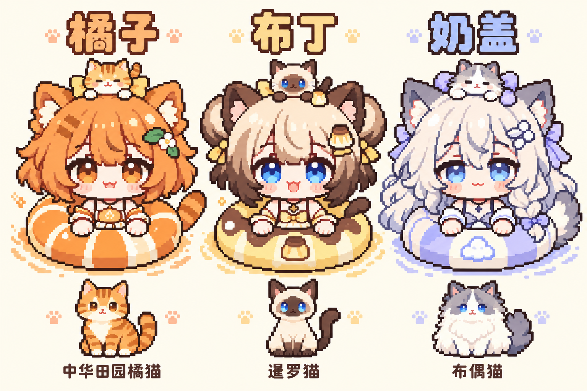

# 喵喵碰碰大作战

> 猫娘套泳圈，小猫满池弹。

一款为 [N.E.K.O](https://github.com/Project-N-E-K-O/N.E.K.O) 设计的猫娘泳圈碰撞小游戏。调整角度和力度，把猫猫弹出去，看她们相互碰撞、借池壁反弹，最后在水的阻力下自然停稳。

**作者：[WhiteFrostune](https://github.com/WhiteFrostune)**

**当前状态：规划与标准插件骨架阶段（`0.1.0.dev0`），尚无可玩的游戏页面。** `0.1.0` 是碰撞手感原型的目标版本；本仓库暂未发布正式游戏版本或安装包。

## 角色与美术方向



| 角色 | 原型猫 | 外形与配饰 |
| --- | --- | --- |
| 橘子 | 中华田园橘猫，橘色虎斑 | 橘色外翘短发、琥珀眼睛、条纹尾巴；头顶小橘猫，橘瓣泳圈 |
| 布丁 | 海豹重点色暹罗猫 | 奶油色头发、深棕发尾、双团子、蓝眼睛；头顶小暹罗，焦糖布丁泳圈 |
| 奶盖 | 蓝双色布偶猫 | 奶白蓬松长发、灰蓝耳尖、蓝眼睛、大毛尾；头顶小布偶，淡紫软垫泳圈 |

角色沿用悠怡 PNGTuber 的大头短身、圆脸和可爱表情语言，转换成有清楚颗粒的像素美术。悠怡是独立角色，三位新角色分别设计自己的轮廓与配色。

图中为生成式概念样板，供讨论外观与配色；正式游戏精灵和动画尚未制作。参考来源见 [概念图说明](docs/art/README.md)。

## 0.1.0 计划做什么

- 一个矩形水池和三个有名字、颜色区分的占位泳圈。
- 拖拽瞄准、力度提示、松手发射、取消和重置。
- 泳圈碰撞、池壁反弹、水阻衰减和自然停稳。
- 单圈撞墙、两圈对撞、三圈连撞和墙角拥挤测试布局。
- 可折叠的调参区，以及高速、缩放、页面暂停恢复等稳定性检查。

先验证“把猫猫弹出去，看她们撞来弹去”是否好玩，再接入正式美术。血量、技能、电脑对手和完整对战属于后续目标。

详细文档：

- [0.1.0 开发规划与验收标准](docs/ROADMAP_0.1.0.md)
- [整体玩法、角色技能与对战设计](docs/GAME_DESIGN.md)
- [插件设计简报与开发边界](DESIGN.md)

## 开发方式

仓库遵循 N.E.K.O 独立插件约定，仓库名为 `n.e.k.o_plugin_miao_miao_bump`，插件 ID 为 `miao_miao_bump`。

克隆到本地 N.E.K.O 源码的插件目录：

```text
N.E.K.O/plugin/plugins/miao_miao_bump/
```

在 N.E.K.O 仓库根目录运行：

```bash
git clone https://github.com/WhiteFrostune/n.e.k.o_plugin_miao_miao_bump.git plugin/plugins/miao_miao_bump
uv run neko-plugin check miao_miao_bump --strict
uv run pytest plugin/plugins/miao_miao_bump/tests -q
```

目录已经存在时，使用已有检出目录继续开发。插件通过公开 SDK 接入，默认手动启动；当前骨架只提供生命周期，不会打开游戏或启动后台任务。

后续实现计划采用 Canvas + Matter.js，在浏览器内完成游戏循环；独立静态游戏页面、物理引擎和资源均保留在插件目录中。

## 仓库内容

```text
plugin.toml            插件身份、作者与运行配置
__init__.py            标准插件入口与生命周期骨架
pyproject.toml         项目元数据
DESIGN.md              插件设计简报
docs/                  开发规划、整体设计和概念图
i18n/                  插件元数据的八种语言
tests/                 标准骨架检查
.github/workflows/     标准验证与标签发布流程
```

当前目标是完成规划中的 0.1.0，再进行试玩调参；版本完成前不创建对应的发布标签。
