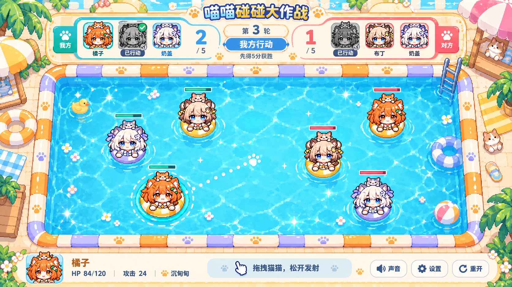

# 对战界面与多地图预留

2026-10-20：用户选定第一张对战界面概念图，并要求今后支持不同地图。

状态：界面方向已选定，地图配置接口已在 dev9 第一阶段完成，见 [已实现接口](MAPS.md)。当前正式地图仍为夏日水池；顶部头像与新对战规则尚未实现。

下一版本的回合、积分复归与飞出淘汰动画一起收录于 [dev9 对战整合计划](DEV9_PLAN.md)。

## 已选界面

- 顶部独立记分牌：双方各三个猫娘头像，比分居两侧，轮次和当前行动方居中。
- 每轮已主动出手的角色头像变灰并加勾；当前选择突出显示。水池内的角色保持彩色，继续参与碰撞。
- 水池保留独立的可玩区域，顶部头像和底部操作均不占水面。按剩余可用宽高等比缩放，完整画面留在首屏。
- 底部集中显示选中角色、血量、攻击与被动，以及声音、设置和重开。
- 不恢复明显碰撞、本次用时、当前速度、发射力度四项显示。
- 概念图中的比分、5 分目标、装饰物和角色位置用于说明布局；具体数值、复归时机和场景物体的交互不因选图自动成为已实现规则。

## 地图与公共界面分开

角色、队伍、行动次数、伤害、比分和胜负属于对战系统。顶部头像、记分牌和底栏属于公共界面。它们不画入地图图片，不随地图重复制作，也不由地图资源控制。

地图独立提供美术、场地和出生点。同一套公共界面可以显示夏日水池或后续地图；更换地图皮肤不应改变猫娘技能或已确认的基础碰撞手感。

## 地图配置职责

以下说明配置职责；当前可调用接口和限制以 [地图接口](MAPS.md) 为准。矩形池壁已配置化，静态障碍物和机关仍是后续扩展，当前非空配置会明确拒绝。

| 配置 | 职责 |
| --- | --- |
| `id`、`nameKey` | 稳定地图标识与国际化名称；对战记录使用标识，不绑定图片路径 |
| `art` | 地图图片、像素网格、池沿切片、水纹与必要的渲染元数据 |
| `world` | 逻辑宽高与可玩边界；第一张地图保持当前 960 × 600 场地及边界 |
| `spawns` | 双方各三只猫的出生位置、己方合法复归区域与朝向预留；未来复归也从同一配置取位置 |
| `colliders` | 声明式碰撞体列表；首版保持矩形池壁，后续可加入静态障碍物 |
| `mechanics` | 预留地图机制配置；首版为空，不提前加入水流、漩涡或伤害机关 |

以地图注册表按 `id` 查找配置，默认项是现有夏日水池。增加同类地图时添加资源和配置，避免在对战流程中增加按地图名称分支的判断。新的机关行为仍需明确实现，不能仅换图片就声称支持。

## 共用场地数据

- 物理池壁、瞄准预览、电脑选线、角色出生／复归和地图绘制读取同一份场地数据。
- 角色绘制和指针坐标换算使用该地图的逻辑尺寸；地图变宽变窄时，不能只拉伸图片。
- 美术水面内缘与真实碰撞边界一致。背景中的装饰物不会自动成为碰撞体；可碰撞物体须有清楚的外观和对应配置。
- 当前地图的水阻、反弹、角色半径和发射参数保持原值。后续地图若改变手感，须作为明确的地图规则单独调试。

## 载入与切换边界

- 地图切换入口放在开局设置中；进行中的对局不直接热换地图。重开保留当前地图选择。
- 先校验完整配置和资源，再一次性建立场地、出生点和对战状态，避免画面与物理各用了不同地图。
- 出生点须在可玩范围内，不能与池壁、障碍物或其他出生角色重叠。
- 未知地图标识或无效场地配置在开局前回退默认地图并给出提示；仅美术载入失败时保留所选有效物理配置，以程序绘制该场地，不能偷偷替换为另一张地图的边界。
- 切换／重开清理旧碰撞体、接触记录、拖拽、视觉反馈和电脑行动；旧资源异步返回不得覆盖新地图。

## 实现时的验收重点

先用当前夏日水池验证配置化前后碰撞手感不变，再用第二份测试配置验证：可玩边界、出生点、瞄准、电脑与画面同步；不同窗口下头像、水池和底栏都完整可见；切换与资源失败不会混用场地。暂不为预留接口制作额外正式地图。
