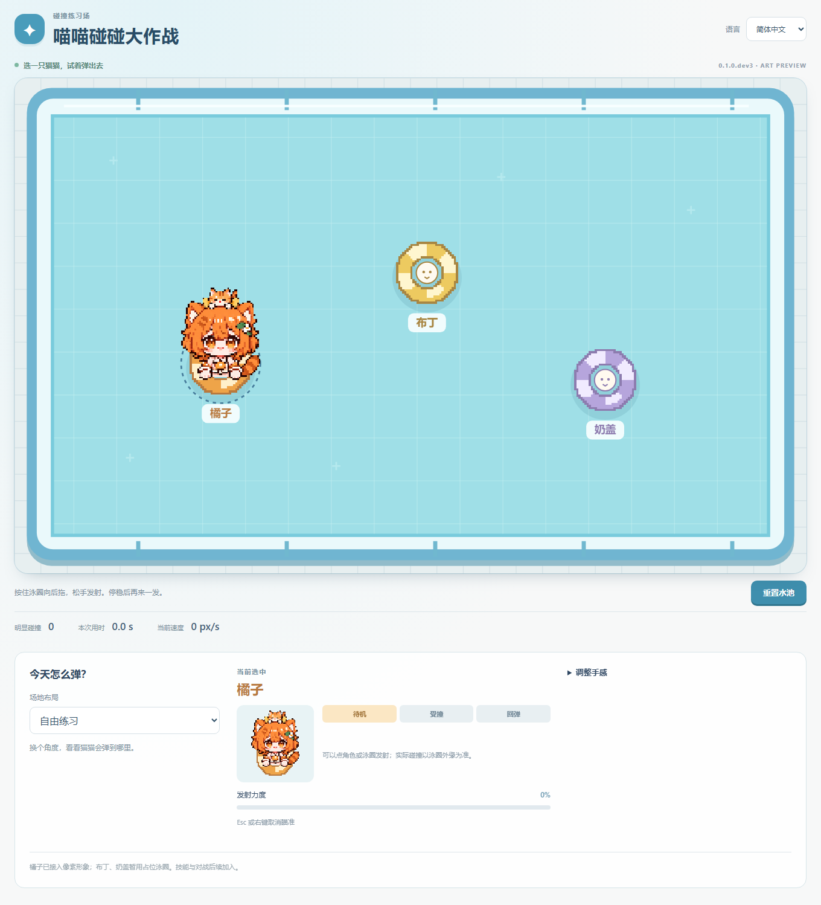

# 美术资源与概念图

## 已接入游戏的橘子样稿

- [透明表情图集](../../static/assets/juzi-expressions.png)：待机、受撞、回弹三种表情；本轮只制作橘子。
- [帧与绘制尺寸](../../static/assets/juzi.json)：图集为 1536 × 1024，三帧先用最近邻采样到 48 × 56 游戏像素网格，透明边缘硬化，再以 2 倍绘制到 96 × 112 逻辑像素；角色移动也对齐像素网格，避免高分辨率细节缩成模糊小点。未对生成文件另做图像编辑。
- 泳圈由游戏代码绘制为 32 × 32 像素图，显示直径 80；碰撞为半径 40 的圆形刚体。挤压与角色晃动属于视觉反馈。
- [生成提示与资源来源记录](juzi-sprite-prompts.md)：完整生成、整理提示，以及采用的原始文件。

这是用于验证实际大小、视角、遮挡和受撞表现的第一轮游戏样稿。布丁、奶盖继续用占位形象；完整逐帧动作、音效和其他角色资源尚未完成。

## 方向参考

以下图片用于讨论人物设定、像素颗粒、配色与泳圈表现，不作为游戏图集直接使用。

- [角色概念图](character-concepts.png)：橘子、布丁和奶盖，以及对应原型猫。
- [悠怡像素风研究](yui-pixel-style-study.png)：用于确认原有 PNGTuber 风格如何转为泳圈角色的像素造型。

参考来源是 [Project N.E.K.O](https://github.com/Project-N-E-K-O/N.E.K.O) 项目现有的 YUI Origin、YUI Lolita、YUI Sister PNGTuber 美术。悠怡及原项目角色、品牌的权利归其原权利人。

本项目作者为 WhiteFrostune。概念图与橘子样稿在设计讨论中使用内置图像生成工具制作，后续资源继续根据游戏中的实际尺寸、视角、碰撞范围和动画要求整理。
